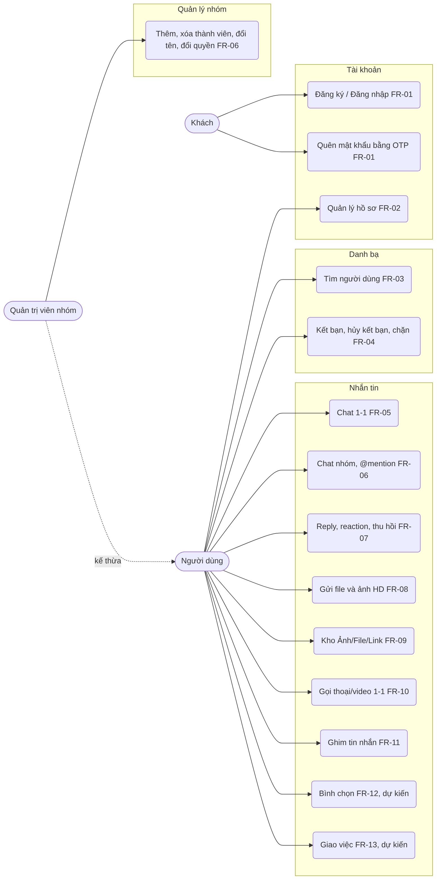
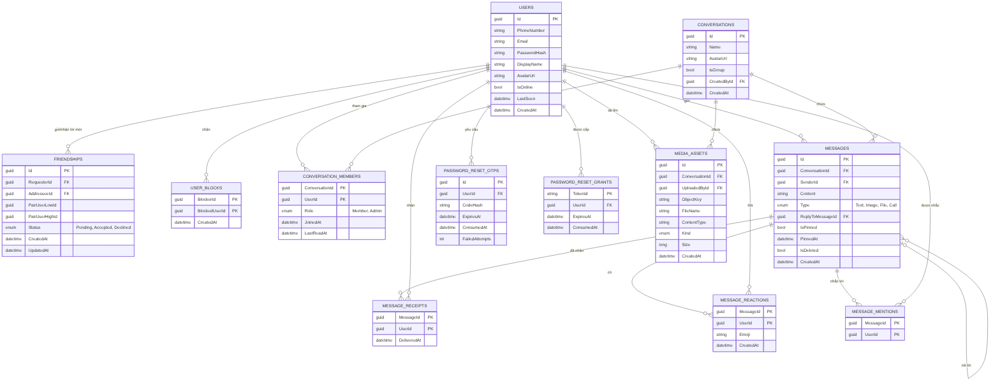
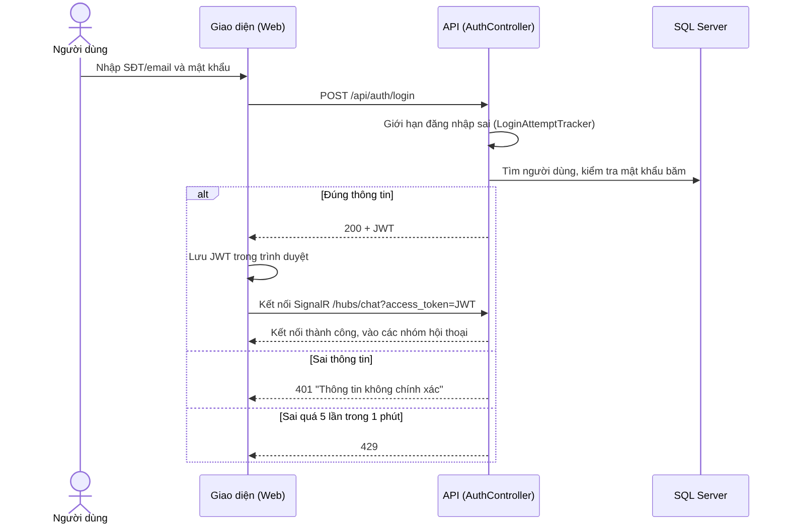
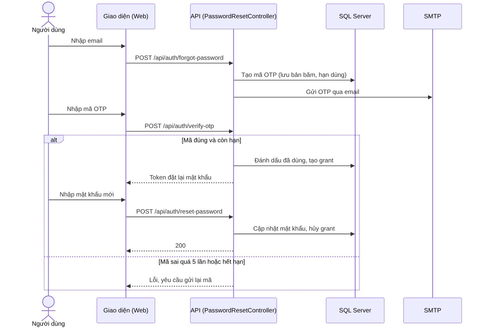
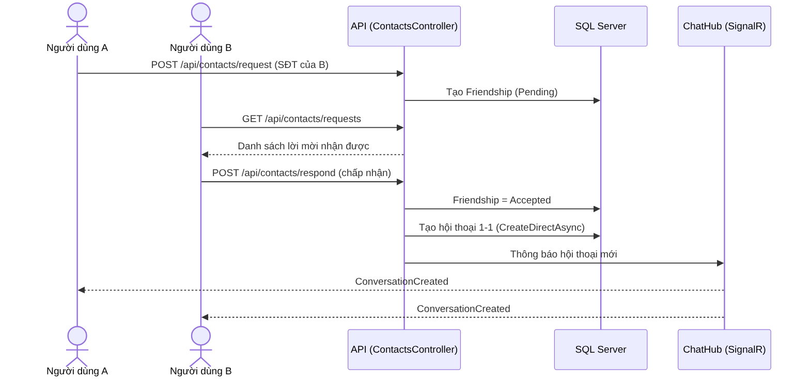
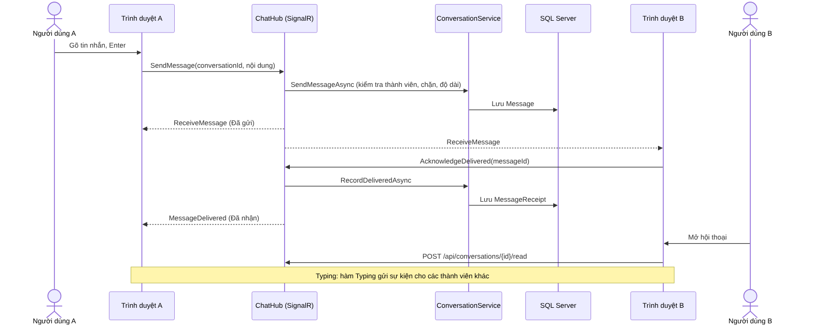
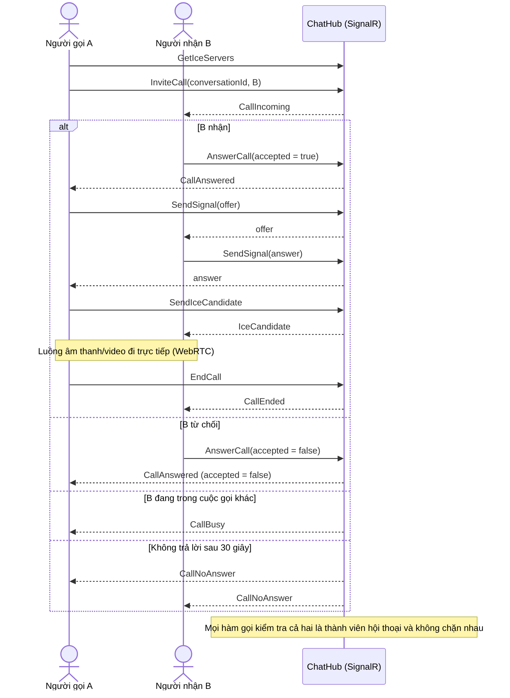
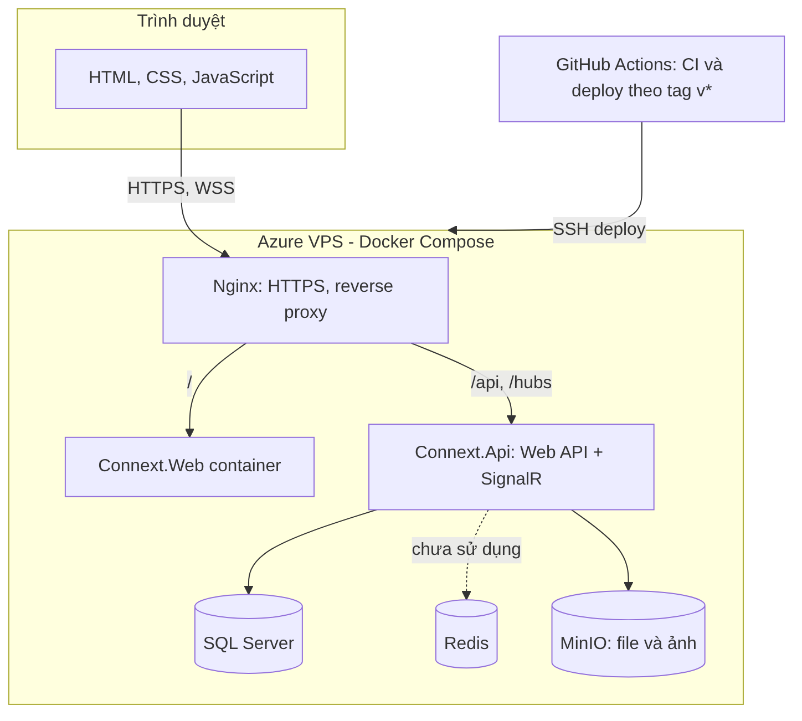

# Sơ đồ hệ thống Connext

Vẽ từ code trên `develop` (sau PR #64), dùng cho báo cáo và slide (#73, #74). Mỗi sơ đồ có bản nguồn Mermaid (`.mmd`, sửa được, GitHub xem trực tiếp) và ảnh PNG xuất sẵn trong thư mục [`diagrams/`](diagrams/).

Ghi chú: FR-12 (bình chọn) và FR-13 (giao việc) mới ở mức dự kiến, chưa có trong ERD vì chưa có migration (#78, #79). Redis có trong Docker Compose nhưng API chưa sử dụng (kết nối SignalR hiện lưu trong bộ nhớ qua `ConnectionTracker`).

## 1. Use case

Các tác nhân và chức năng theo FR-01 đến FR-13.

Nguồn: [`use-case.mmd`](diagrams/use-case.mmd)

## 2. ERD (cơ sở dữ liệu)

12 bảng trong `AppDbContext`: Users, Friendships, UserBlocks, Conversations, ConversationMembers, Messages, MessageReceipts, MessageReactions, MessageMentions, MediaAssets, PasswordResetOtps, PasswordResetGrants.

Nguồn: [`erd.mmd`](diagrams/erd.mmd)

## 3. Sơ đồ tuần tự

### 3.1 Đăng nhập bằng JWT và kết nối SignalR

Nguồn: [`seq-login.mmd`](diagrams/seq-login.mmd)

### 3.2 Quên mật khẩu bằng OTP

Nguồn: [`seq-password-reset.mmd`](diagrams/seq-password-reset.mmd)

### 3.3 Kết bạn và tạo hội thoại 1-1

Nguồn: [`seq-friend.mmd`](diagrams/seq-friend.mmd)

### 3.4 Gửi tin nhắn real-time, Đã gửi, Đã nhận, Đã xem

Nguồn: [`seq-message.mmd`](diagrams/seq-message.mmd)

### 3.5 Gọi thoại/video 1-1 bằng WebRTC qua SignalR

Nguồn: [`seq-call.mmd`](diagrams/seq-call.mmd)

## 4. Kiến trúc triển khai

Nguồn: [`deployment.mmd`](diagrams/deployment.mmd)
